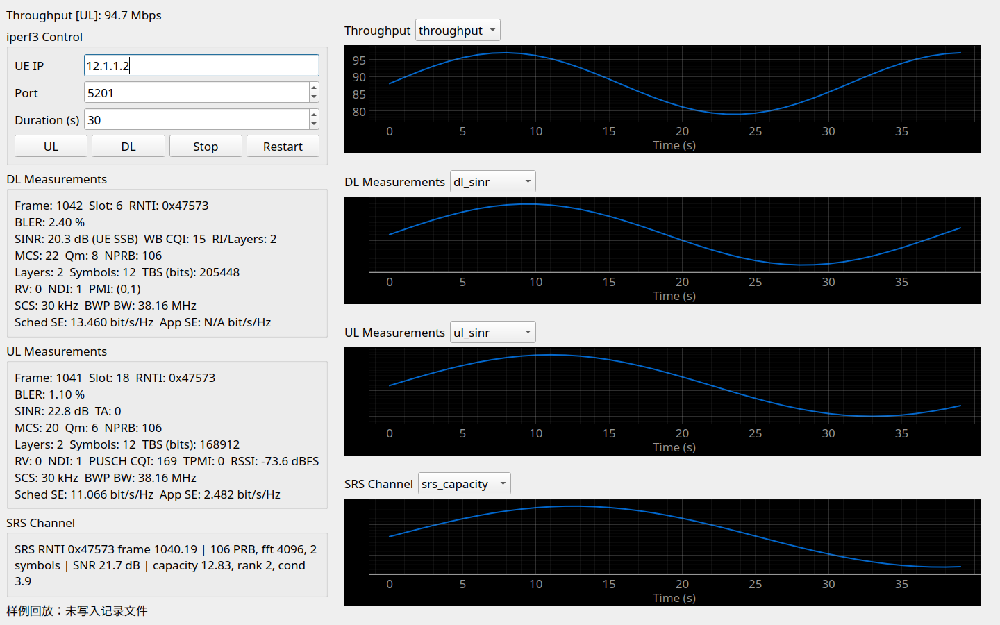
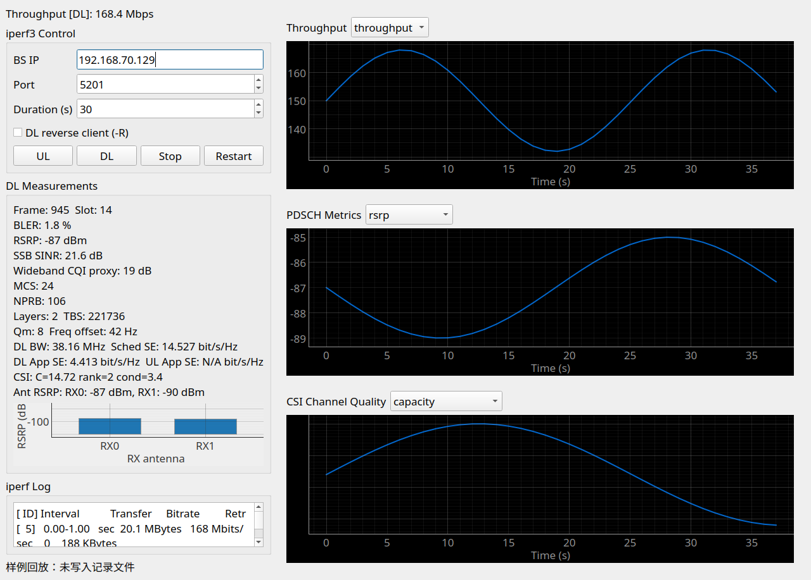

# OAI 5G NR SA 部署、RFSim/USRP 测试与 GUI 监测指南

本文面向当前仓库中的 OAI 5G NR SA 实验环境，覆盖以下内容：

- OAI 5G 核心网部署。
- OAI gNB 和 nrUE 的编译、启动及最小配置说明。
- RFSim 的工作原理、常用功能和测速方法。
- USRP 空口环境下使用 iPerf 测试上下行吞吐。
- gNB/UE Python GUI 的启动、控件配对和变量解读。
- OAI 控制台日志、iPerf 日志、CSV 和信道 `.npy` 文件的保存与判读。
- 运行中切换 UL/DL MIMO 流数，即 hot running layer switching。
- 常见故障定位方法。

> 文档基于仓库提交 `05e9789d5e`（2026-10-18）整理。不同 OAI 版本的命令行参数和配置键可能变化，执行前应先用 `--help` 或检查当前配置文件。

> 本文截图来自当前仓库 GUI 的真实 PyQt 界面，但指标使用已有记录中同量纲的样例数据回放填充，仅用于说明字段和布局。截图中的吞吐量、RSRP、SINR 等数值不代表某次现场测试结果。

## 目录

1. [先选部署方式](#1-先选部署方式)
2. [环境准备和编译](#2-环境准备和编译)
3. [部署 OAI 核心网](#3-部署-oai-核心网)
4. [启动 OAI gNB 和 nrUE](#4-启动-oai-gnb-和-nrue)
5. [配置文件简要解读](#5-配置文件简要解读)
6. [RFSim 功能说明](#6-rfsim-功能说明)
7. [iPerf 测速](#7-iperf-测速)
8. [GUI 开启和变量解读](#8-gui-开启和变量解读)
9. [日志保存和解读](#9-日志保存和解读)
10. [Hot running 流数切换](#10-hot-running-流数切换)
11. [常见问题](#11-常见问题)
12. [一键式命令清单](#12-一键式命令清单)
13. [相关文档和源码位置](#13-相关文档和源码位置)

## 1. 先选部署方式

最容易混淆的是核心网、gNB 和 nrUE 到底运行在宿主机还是容器中。当前仓库同时提供了两套相近但地址不同的部署资源。

### 1.1 方案 A：本机 OAI 进程 + 容器核心网

适合：

- 在开发机上直接运行 `nr-softmodem` 和 `nr-uesoftmodem`。
- 调试 telnet、GUI、日志和源码改动。
- RFSim 和 USRP 都使用同一套本机进程启动方式。

使用目录：

```text
doc/tutorial_resources/oai-cn5g
```

关键地址：

| 网元 | 地址 |
|---|---|
| 核心网 Docker 网络 | `192.168.70.128/26` |
| AMF | `192.168.70.132` |
| UPF | `192.168.70.134` |
| 外部数据网容器 `oai-ext-dn` | `192.168.70.135` |
| 宿主机上的 gNB N2/N3 地址 | 通常为 Docker 网桥地址 `192.168.70.129` |
| UE TUN 地址 | DNN `oai` 网段中的 `10.0.0.x`，常见为 `10.0.0.2` |

注意：宿主机 gNB 配置中的 `GNB_IPV4_ADDRESS_FOR_NG_AMF` 和 `GNB_IPV4_ADDRESS_FOR_NGU` 必须是宿主机真实可达的地址，不能照抄容器内的 `.140`。

### 1.2 方案 B：核心网、gNB、nrUE 全部在容器中

适合：

- 快速验证 OAI CN5G、gNB 和 nrUE 的全栈互通。
- 不希望手工管理本机进程、TUN 和动态库路径。
- 主要做 RFSim 功能验证。

使用目录：

```text
ci-scripts/yaml_files/5g_rfsimulator
```

关键地址：

| 网元 | 地址 |
|---|---|
| 核心网 Docker 网络 | `192.168.71.0/26` |
| AMF | `192.168.71.132` |
| UPF | `192.168.71.134` |
| gNB | `192.168.71.140` |
| nrUE | `192.168.71.150` |
| 外部数据网容器 | `192.168.72.135` |
| UE TUN 地址 | `12.1.1.x`，通常为 `12.1.1.2` |

这套 compose 文件预先配置了 PLMN `208/99`、DNN `oai`、IMSI `208990100001100` 等参数。不要把它与方案 A 的 PLMN `001/01` 和 IMSI `001010000000001` 混用。

### 1.3 方案 C：USRP 空口

常见拓扑是：

```text
核心网 + gNB 主机 + USRP  <==== 空口 ====>  nrUE 主机 + USRP
                                           或 COTS UE
```

空口环境下 PHY/MAC 协议栈和核心网流程与 RFSim 相同，区别是样本经 USRP 收发，不再经 TCP 端口 `4043` 在进程间转发。

## 2. 环境准备和编译

### 2.1 目录约定

以下命令默认从仓库根目录执行：

```bash
cd /path/to/openairinterface5g
mkdir -p logs
```

常见构建目录：

```text
cmake_targets/ran_build/build
```

如果使用了 `build_oai -d <name>`，实际目录可能是：

```text
cmake_targets/<name>/build
```

后文用 `$OAI_BUILD` 表示实际构建目录：

```bash
export OAI_ROOT="$PWD"
export OAI_BUILD="$OAI_ROOT/cmake_targets/ran_build/build"
```

### 2.2 安装依赖

首次编译可执行：

```bash
cd "$OAI_ROOT/cmake_targets"
./build_oai -I
```

USRP 环境还需确认 UHD 能找到设备：

```bash
uhd_find_devices
uhd_usrp_probe
```

B210、N300、X300 等设备的 UHD 驱动安装和 FPGA 镜像下载方法，参见：

- `doc/NR_SA_Tutorial_OAI_nrUE.md`
- `doc/RUNMODEM.md`

### 2.3 编译 gNB、nrUE 和 telnet 控制库

RFSim/软件仿真构建：

```bash
cd "$OAI_ROOT/cmake_targets"
./build_oai \
  --ninja \
  --gNB \
  --nrUE \
  -w SIMU \
  --build-lib telnetsrv
```

USRP 构建：

```bash
cd "$OAI_ROOT/cmake_targets"
./build_oai \
  --ninja \
  --gNB \
  --nrUE \
  -w USRP \
  --build-lib telnetsrv
```

如果只调试 RFSim，可以用 `SIMU`。如果要在 USRP 上运行，必须确认构建时找到了 UHD，并且 `nr-softmodem`、`nr-uesoftmodem` 链接了正确的射频驱动。

编译完成后至少确认以下文件存在：

```bash
ls -l "$OAI_BUILD"/nr-softmodem
ls -l "$OAI_BUILD"/nr-uesoftmodem
ls -l "$OAI_BUILD"/libtelnetsrv*.so
```

hot running MIMO 流数切换需要：

```text
libtelnetsrv.so
libtelnetsrv_ci.so
libtelnetsrv_ciUE.so
```

### 2.4 高性能环境建议

USRP 大带宽和实时空口测试建议执行：

```bash
sudo cpupower frequency-set -g performance
sudo sysctl -w net.core.rmem_max=62500000
sudo sysctl -w net.core.wmem_max=62500000
sudo sysctl -w net.core.rmem_default=62500000
sudo sysctl -w net.core.wmem_default=62500000
```

对 N300/X300 的 10G 网卡，可根据接口名调整 ring buffer：

```bash
sudo ethtool -G <ifname> rx 4096 tx 4096
```

不要机械照搬所有调优项。先确认网卡、CPU、USRP 型号和带宽能力，再逐项增加。

## 3. 部署 OAI 核心网

### 3.1 方案 A：用于本机 OAI gNB/nrUE 的核心网

建议把教程资源复制到仓库外，避免运行时在 Git 工作区产生文件：

```bash
cp -a "$OAI_ROOT/doc/tutorial_resources/oai-cn5g" ~/oai-cn5g
cd ~/oai-cn5g
```

拉取镜像：

```bash
docker compose pull
```

启动：

```bash
docker compose up -d
docker compose ps
```

等待 `mysql`、`oai-amf`、`oai-smf`、`oai-upf`、`oai-ext-dn` 等容器进入 healthy 状态。

查看 NF 日志：

```bash
docker logs --tail=200 oai-amf
docker logs --tail=200 oai-smf
docker logs --tail=200 oai-upf
docker logs --tail=200 oai-ext-dn
```

检查 Docker 网桥：

```bash
ip -br address show oai-cn5g
ping -c 2 192.168.70.132
```

教程配置默认使用：

```text
PLMN: 001/01
TAC:  0x0001
SNSSAI/SST: 1
DNN: oai
UE IP 网段: 10.0.0.0/24
```

停止核心网：

```bash
cd ~/oai-cn5g
docker compose down
```

如需删除数据库卷并彻底重置，先确认数据不再需要，再执行：

```bash
docker compose down -v
```

### 3.2 方案 B：全容器 RFSim 核心网

进入仓库中的 compose 目录：

```bash
cd "$OAI_ROOT/ci-scripts/yaml_files/5g_rfsimulator"
```

当前 compose 文件使用 `interface_name` 固定容器接口。`docker compose` 建议使用 `2.36.0` 或更高版本。

该目录的 README 明确要求分步启动。先启动核心网：

```bash
docker compose up -d mysql oai-amf oai-smf oai-upf oai-ext-dn
docker compose ps -a
```

核心网 healthy 后再启动 gNB：

```bash
docker compose up -d oai-gnb
docker compose ps -a
docker logs --tail=200 rfsim5g-oai-gnb
```

确认 AMF 已看到 gNB：

```bash
docker logs --tail=200 rfsim5g-oai-amf
```

最后启动 nrUE：

```bash
docker compose up -d oai-nr-ue
docker compose ps -a
docker logs --tail=200 rfsim5g-oai-nr-ue
```

进入 UE 容器检查 TUN：

```bash
docker exec -it rfsim5g-oai-nr-ue ip -br address
docker exec -it rfsim5g-oai-nr-ue ip route
```

预期能看到 `oaitun_ue1` 和类似 `12.1.1.2` 的地址。

停止全部容器：

```bash
docker compose down
```

### 3.3 核心网组件作用

| 组件 | 作用 |
|---|---|
| MySQL | 保存用户签约、鉴权、会话策略等数据 |
| AMF | 5G 接入和移动性管理，终结 gNB 的 N2/NGAP |
| SMF | PDU Session 管理，控制 UPF 建立用户面规则 |
| UPF | N3/N6 用户面转发，连接 gNB 和外部数据网 |
| AUSF/UDM/UDR | 鉴权、签约数据和用户数据服务，见完整教程 compose |
| NRF | NF 注册和发现，完整教程 compose 中包含 |
| `oai-ext-dn` | 外部数据网容器，常用于 ping 和 iPerf |

### 3.4 核心网和 RAN 必须一致的关键参数

| 参数 | gNB | 核心网 | UE |
|---|---|---|---|
| PLMN | `plmn_list` 中 MCC/MNC | AMF `plmn_support_list` | SIM/UICC IMSI 的前缀应匹配 |
| TAC | `tracking_area_code` | AMF `tac` | 由网络侧使用 |
| SST/SD | `snssaiList` | AMF/UPF 的 S-NSSAI | UE `pdu_sessions.nssai_sst` |
| DNN | 由核心网/SMF下发 | SMF/UPF/数据库 | UE `pdu_sessions.dnn` |
| IMSI | 不直接配置 | 数据库用户表 | `uicc0.imsi` |
| KEY/OPC | 不直接配置 | 鉴权数据库 | `uicc0.key`、`uicc0.opc` |

方案 A 的常用 UE 身份：

```text
IMSI: 001010000000001
KEY:  fec86ba6eb707ed08905757b1bb44b8f
OPC:  C42449363BBAD02B66D16BC975D77CC1
DNN:  oai
SST:  1
```

方案 B 的默认 UE 身份通常是：

```text
IMSI: 208990100001100
DNN:  oai
SST:  1
```

鉴权失败、Registration reject、PDU Session 建立失败时，首先检查这组参数是否完全匹配。

## 4. 启动 OAI gNB 和 nrUE

### 4.1 RFSim 主推荐配置

推荐的本机 RFSim 配置文件：

```text
targets/PROJECTS/GENERIC-NR-5GC/CONF/gnb.sa.band78.fr1.106PRB.pci0.rfsim.conf
```

该配置的主要特征：

```text
Band 78
106 PRB
30 kHz SCM
中心频率约 3600 MHz
PLMN 001/01
AMF 192.168.70.132
RFSim 服务端口 4043
```

先启动 gNB：

```bash
cd "$OAI_BUILD"
./nr-softmodem \
  -O "$OAI_ROOT/targets/PROJECTS/GENERIC-NR-5GC/CONF/gnb.sa.band78.fr1.106PRB.pci0.rfsim.conf" \
  --rfsim \
  --rfsimulator.[0].serveraddr server \
  --gNBs.[0].min_rxtxtime 6 \
  --log_config.global_log_options level,nocolor,time \
  2>&1 | tee "$OAI_ROOT/logs/rfsim_gnb_$(date +%Y%m%d_%H%M%S).log"
```

看到 RFSim 服务端监听和 gNB 启动完成后，再启动 nrUE：

```bash
cd "$OAI_BUILD"
./nr-uesoftmodem \
  -O "$OAI_ROOT/ci-scripts/conf_files/nrue.uicc.conf" \
  --uicc0.imsi 001010000000001 \
  -r 106 \
  --numerology 1 \
  --band 78 \
  -C 3619200000 \
  --ssb 516 \
  --rfsim \
  --rfsimulator.[0].serveraddr 127.0.0.1 \
  --log_config.global_log_options level,nocolor,time \
  2>&1 | tee "$OAI_ROOT/logs/rfsim_nrue_$(date +%Y%m%d_%H%M%S).log"
```

如果使用 `sudo`，保留用户环境变量：

```bash
sudo -E ./nr-softmodem ...
sudo -E ./nr-uesoftmodem ...
```

RFSim 本身不一定要求 root。只有在需要 TUN、raw socket、实时调度权限或设备权限时才使用 `sudo`。

### 4.2 启动成功的参考日志

gNB 侧通常应能看到：

```text
Starting nr-softmodem
RU 0 rf device ready
Starting RU ...
```

连接 AMF 后，AMF 日志应能看到 gNB 状态为 connected，并显示 PLMN。不同版本的具体格式可能不同。

nrUE 侧常见成功标志包括：

```text
Got synch
UE synchronized
RA procedure succeeded
RRC Setup
Registration Accept
PDU Session Establishment Accept
```

版本和日志级别不同，字符串可能略有差异。只要 RRC、NAS、PDU Session 和 TUN 地址都正常，就说明端到端流程已经建立。

### 4.3 快速检查端到端连通性

查看接口：

```bash
ip -br address show
ip route
```

查找 `oaitun_ue1`。方案 A 常见 UE 地址为 `10.0.0.2`，方案 B 常见为 `12.1.1.2`。

从 UE 所在命名空间或容器 ping 外部数据网：

```bash
ping -I oaitun_ue1 -c 4 192.168.70.135
```

方案 B：

```bash
docker exec -it rfsim5g-oai-nr-ue ping -I oaitun_ue1 -c 4 192.168.72.135
```

从外部数据网反向 ping UE：

```bash
docker exec -it oai-ext-dn ping -c 4 <UE_IP>
```

方案 B：

```bash
docker exec -it rfsim5g-oai-ext-dn ping -c 4 12.1.1.2
```

### 4.4 USRP 启动

先在 gNB 主机确认设备：

```bash
uhd_find_devices
```

B210：

```bash
cd "$OAI_BUILD"
sudo -E ./nr-softmodem \
  -O "$OAI_ROOT/targets/PROJECTS/GENERIC-NR-5GC/CONF/gnb.sa.band78.fr1.106PRB.usrpb210.conf" \
  -E \
  --continuous-tx \
  --gNBs.[0].min_rxtxtime 6 \
  --log_config.global_log_options level,nocolor,time
```

N300：

```bash
cd "$OAI_BUILD"
sudo -E ./nr-softmodem \
  -O "$OAI_ROOT/targets/PROJECTS/GENERIC-NR-5GC/CONF/gnb.sa.band77.fr1.273PRB.2x2.usrpn300.conf" \
  --usrp-tx-thread-config 1 \
  --gNBs.[0].min_rxtxtime 6 \
  --log_config.global_log_options level,nocolor,time
```

X300 通常也建议单 TX 线程配置：

```bash
sudo -E ./nr-softmodem \
  -O "$OAI_ROOT/targets/PROJECTS/GENERIC-NR-5GC/CONF/gnb.sa.band77.fr1.273PRB.2x2.usrpn300.conf" \
  --usrp-tx-thread-config 1 \
  -E \
  --continuous-tx \
  --gNBs.[0].min_rxtxtime 6
```

OAI nrUE 使用另一台主机和另一个 USRP 时：

```bash
cd "$OAI_BUILD"
sudo -E ./nr-uesoftmodem \
  -O "$OAI_ROOT/ci-scripts/conf_files/nrue.uicc.conf" \
  --uicc0.imsi 001010000000001 \
  -r 106 \
  --numerology 1 \
  --band 78 \
  -C 3619200000 \
  --ssb 516 \
  --ue-fo-compensation \
  --ue-nb-ant-tx 2 \
  --ue-nb-ant-rx 2 \
  --log_config.global_log_options level,nocolor,time
```

这里不要添加 `--rfsim`。如果 USRP 型号、频段、PRB 数或中心频率与 gNB 配置不同，必须同步调整。

如果 COTS UE 使用可编程 SIM，常用身份仍为：

```text
IMSI: 001010000000001
KEY:  fec86ba6eb707ed08905757b1bb44b8f
OPC:  C42449363BBAD02B66D16BC975D77CC1
```

### 4.5 正常停止

前台进程使用 `Ctrl+C`，让 OAI 收到 `SIGINT` 并走清理流程。

不要使用 `Ctrl+Z`。`Ctrl+Z` 只是暂停进程，RFSim 端口、telnet 端口、TUN 和共享内存仍可能被占用。

检查残留进程：

```bash
pgrep -a -x nr-softmodem
pgrep -a -x nr-uesoftmodem
sudo ss -ltnp | grep -E ':(4043|19090|19091)\b'
```

## 5. 配置文件简要解读

### 5.1 gNB 顶层结构

典型 gNB 配置为 libconfig 语法：

```text
Active_gNBs
gNBs
MACRLCs
L1s
RUs
rfsimulator
security
log_config
```

### 5.2 gNB 标识和核心网参数

```libconfig
gNB_ID = 0xe00;
gNB_name = "gNB-OAI";
tracking_area_code = 1;
plmn_list = ({
  mcc = 001;
  mnc = 01;
  mnc_length = 2;
  snssaiList = ({ sst = 1; });
});
nr_cellid = 12345678L;
```

| 字段 | 含义 |
|---|---|
| `gNB_ID` | gNB 标识，NGAP 和日志中会使用 |
| `gNB_name` | 可读名称，便于在 AMF 日志中识别 |
| `tracking_area_code` | TAC，必须与 AMF 服务的 TAC 一致 |
| `plmn_list` | MCC/MNC 和切片信息 |
| `nr_cellid` | NR Cell Identity |

网络接口：

```libconfig
amf_ip_address = ({ ipv4 = "192.168.70.132"; });

NETWORK_INTERFACES : {
  GNB_IPV4_ADDRESS_FOR_NG_AMF = "192.168.70.129/24";
  GNB_IPV4_ADDRESS_FOR_NGU = "192.168.70.129/24";
  GNB_PORT_FOR_S1U = 2152;
};
```

| 字段 | 含义 |
|---|---|
| `amf_ip_address` | AMF 的 N2/NGAP 地址 |
| `GNB_IPV4_ADDRESS_FOR_NG_AMF` | gNB 用于连接 AMF 的本地地址 |
| `GNB_IPV4_ADDRESS_FOR_NGU` | gNB 用于 GTP-U N3 的本地地址 |
| `GNB_PORT_FOR_S1U` | GTP-U 端口，5G 仍常沿用 2152 |

全容器 RFSim 中这些地址应为 `192.168.71.x`。本机进程方案中则应为 `192.168.70.x` 中宿主机实际拥有的地址。

### 5.3 小区和频域参数

```libconfig
physCellId = 0;
absoluteFrequencySSB = 641280;
dl_frequencyBand = 78;
dl_absoluteFrequencyPointA = 640008;
dl_subcarrierSpacing = 1;
dl_carrierBandwidth = 106;
initialDLBWPlocationAndBandwidth = 28875;
ul_subcarrierSpacing = 1;
ul_carrierBandwidth = 106;
```

| 字段 | 含义 |
|---|---|
| `physCellId` | PCI，UE 初始搜索和小区识别使用 |
| `absoluteFrequencySSB` | SSB 的 ARFCN |
| `dl_absoluteFrequencyPointA` | DL Point A 的 ARFCN |
| `dl_frequencyBand` / `ul_frequencyBand` | NR 频段，例如 n78 |
| `*_subcarrierSpacing` | `0=15 kHz`、`1=30 kHz`、`2=60 kHz`、`3=120 kHz` |
| `*_carrierBandwidth` | 载波 PRB 数 |
| `initial*BWPlocationAndBandwidth` | 初始 BWP 的位置和带宽编码 |

`106 PRB @ 30 kHz` 的标称信道带宽为：

```text
106 * 12 * 30 kHz = 38.16 MHz
```

这也是 GUI 中应用层频谱效率计算使用的 BWP 带宽。

### 5.4 TDD 帧结构

```libconfig
referenceSubcarrierSpacing = 1;
dl_UL_TransmissionPeriodicity = 6;
nrofDownlinkSlots = 7;
nrofDownlinkSymbols = 6;
nrofUplinkSlots = 2;
nrofUplinkSymbols = 4;
```

| 字段 | 含义 |
|---|---|
| `dl_UL_TransmissionPeriodicity` | TDD 周期，`6` 通常对应 5 ms |
| `nrofDownlinkSlots` | 每周期全下行 slot 数 |
| `nrofDownlinkSymbols` | 特殊 slot 中的 DL 符号数 |
| `nrofUplinkSlots` | 每周期全上行 slot 数 |
| `nrofUplinkSymbols` | 特殊 slot 中的 UL 符号数 |

上下行吞吐测试必须考虑该 TDD pattern。即使 PHY 标称带宽为 38.16 MHz，实际上下行峰值也不能简单按全带宽满速率估算。

### 5.5 随机接入和功率参数

重点字段：

```libconfig
prach_ConfigurationIndex = 98;
prach_msg1_FDM = 0;
preambleReceivedTargetPower = -96;
preambleTransMax = 6;
powerRampingStep = 1;
p0_NominalWithGrant = -90;
p0_nominal = -90;
ssPBCH_BlockPower = -25;
```

| 字段 | 含义 |
|---|---|
| `prach_ConfigurationIndex` | PRACH 时域配置 |
| `prach_msg1_FDM` | 一个 RACH occasion 的频分复用数 |
| `preambleReceivedTargetPower` | gNB 期望接收的 preamble 功率 |
| `preambleTransMax` | 最大 preamble 尝试次数 |
| `powerRampingStep` | 每次失败后的功率抬升等级 |
| `p0_NominalWithGrant` | PUSCH 标称功率基准 |
| `p0_nominal` | PUCCH 标称功率基准 |
| `ssPBCH_BlockPower` | SSB 参考功率 |

UE 一直发 preamble、没有 Msg3/Msg4 或 RSRP 异常时，要同时检查这些功率参数、USRP gain、射频线缆和 `rsrp_ThresholdSSB`。

### 5.6 MIMO 配置

下行逻辑天线端口：

```libconfig
pdsch_AntennaPorts_XP = 2;
pdsch_AntennaPorts_N1 = 2;
pdsch_AntennaPorts_N2 = 1;
```

总 DL 逻辑端口数为：

```text
XP * N1 * N2 = 2 * 2 * 1 = 4
```

相关字段：

| 字段 | 含义 |
|---|---|
| `pdsch_AntennaPorts_*` | PDSCH/CSI-RS 逻辑天线端口 |
| `maxMIMO_layers` | RRC 允许的最大 DL MIMO 层数 |
| `pusch_AntennaPorts` | UE 可使用的 PUSCH 天线端口数 |
| `do_CSIRS = 1` | 启用 CSI-RS，DL MIMO 和 CSI 反馈的前提 |
| `do_SRS = "periodic"` | 启用周期 SRS，UL rank/TPMI 测量的前提 |
| `RUs.nb_tx` | 物理/虚拟 RU TX 通道数 |
| `RUs.nb_rx` | 物理/虚拟 RU RX 通道数 |

希望稳定使用 2 层时，至少要保证：

```text
DL logical ports >= 2
maxMIMO_layers >= 2
RUs.nb_tx >= 2
RUs.nb_rx >= 2
UE RX/TX 天线和 UE capability 支持 2 层
```

4 层还要求 UE CSI/SRS 端口、UE capability、gNB RU 通道和当前 TPMI 实现共同支持。只把 telnet override 改成 4 不代表实际一定能调度 4 层。

### 5.7 RU 和 USRP 配置

```libconfig
RUs = ({
  local_rf = "yes";
  nb_tx = 2;
  nb_rx = 2;
  att_tx = 0;
  att_rx = 0;
  bands = [78];
  max_pdschReferenceSignalPower = -27;
  max_rxgain = 114;
  clock_src = "internal";
  sdr_addrs = "type=b200";
});
```

| 字段 | 含义 |
|---|---|
| `local_rf` | 使用本地 RU |
| `nb_tx` / `nb_rx` | TX/RX 通道数 |
| `att_tx` / `att_rx` | 软件配置中的 TX/RX 衰减参数，具体语义受驱动影响 |
| `bands` | RU 支持的频段 |
| `max_pdschReferenceSignalPower` | PDSCH 参考信号功率上限 |
| `max_rxgain` | RX gain 上限 |
| `clock_src` | USRP 时钟源，单设备常用 `internal` |
| `time_src` | 时间源 |
| `sdr_addrs` | UHD 设备选择字符串 |

使用外部 10 MHz 或 GPS 时，必须让所有相关设备共享同一时钟和时间源，否则会出现频率偏差、slot 漂移或无法同步。

### 5.8 RFSim 配置

```libconfig
rfsimulator = ({
  serveraddr = "server";
  serverport = 4043;
  options = ();
  modelname = "AWGN";
  IQfile = "/tmp/rfsimulator.iqs";
});
```

| 字段 | 含义 |
|---|---|
| `serveraddr = "server"` | 当前进程作为 RFSim TCP 服务端，通常用于 gNB |
| `serveraddr = "127.0.0.1"` | 当前进程连接本地 RFSim 服务端，通常用于 UE |
| `serverport` | RFSim TCP 端口，默认 4043 |
| `options` | 运行时选项，例如 `chanmod`、`saviq` |
| `modelname` | 默认模型名，常配合 `chanmod` |
| `IQfile` | `saviq` 保存 IQ 时使用的文件 |
| `prop_delay` | 模拟传播时延，单位 ms |
| `wait_timeout` | 无 UE 连接时的等待超时 |

### 5.9 UE 配置

典型 nrUE 配置：

```libconfig
uicc0 = {
  imsi = "001010000000001";
  key = "fec86ba6eb707ed08905757b1bb44b8f";
  opc = "C42449363BBAD02B66D16BC975D77CC1";
  pdu_sessions = ({
    dnn = "oai";
    nssai_sst = 1;
  });
};
```

| 字段 | 含义 |
|---|---|
| `imsi` | UE 永久身份，必须存在于核心网用户数据库 |
| `key` | 5G-AKA 长期密钥 |
| `opc` | Operator Code，必须与核心网一致 |
| `pdu_sessions.dnn` | 请求的数据网络名称 |
| `pdu_sessions.nssai_sst` | 请求的切片类型 |

命令行可以覆盖配置值：

```bash
--uicc0.imsi 001010000000001
```

多 UE 测试时必须为每个 UE 使用不同 IMSI，并在数据库中有对应签约。

### 5.10 日志配置

```libconfig
log_config : {
  global_log_level = "info";
  phy_log_level = "info";
  mac_log_level = "info";
  rlc_log_level = "info";
  pdcp_log_level = "info";
  rrc_log_level = "info";
  ngap_log_level = "debug";
};
```

日志级别从低到高通常为：

```text
error < warn < info < debug < trace
```

级别越高，输出越详细，也越容易影响实时性能。空口峰值测试时不要让 PHY/MAC 长时间处于 `debug` 或 `trace`。

常用显示选项：

```bash
--log_config.global_log_options level,nocolor,time
```

| 选项 | 作用 |
|---|---|
| `level` | 显示 error/warn/info/debug 等级 |
| `nocolor` | 关闭 ANSI 颜色，适合保存日志 |
| `time` | 显示时间 |
| `thread` | 显示线程名 |
| `thread_id` | 显示线程 ID |
| `function` | 显示函数名 |
| `line_num` | 显示源码行号 |

需要单独提高某模块级别时：

```bash
--log_config.mac_log_level debug
--log_config.phy_log_level debug
```

## 6. RFSim 功能说明

### 6.1 RFSim 是什么

RFSim 用虚拟 RF 设备替代 USRP/FHI 射频前端：

```text
gNB PHY/MAC
    |
RFSim gNB endpoint, TCP 4043
    |
虚拟信道、时延、增益
    |
RFSim UE endpoint
    |
nrUE PHY/MAC
```

对上层协议栈而言，它看起来仍是一块 RF 板卡。gNB 通常作为 TCP server，UE 作为 client 连接。

RFSim 不是实时射频采样系统。它由 CPU 和网络传输能力驱动，可能比实时快，也可能比实时慢。因此：

- 适合协议流程、调度、MIMO、GUI 和日志调试。
- 不适合直接宣称某 USRP 或某带宽的物理峰值性能。
- iPerf 结果反映当前 CPU、虚拟信道、调度和实现开销。

### 6.2 同机连接

gNB：

```bash
--rfsim --rfsimulator.[0].serveraddr server
```

UE：

```bash
--rfsim --rfsimulator.[0].serveraddr 127.0.0.1
```

配置文件里已经包含 server 地址时，可以省略对应命令行覆盖。

### 6.3 跨机连接

假设 gNB 主机地址为 `192.168.2.10`：

```bash
# gNB
--rfsim --rfsimulator.[0].serveraddr server --rfsimulator.[0].serverport 4043

# UE
--rfsim --rfsimulator.[0].serveraddr 192.168.2.10 --rfsimulator.[0].serverport 4043
```

检查连通性和端口：

```bash
ping -c 3 192.168.2.10
nc -vz 192.168.2.10 4043
```

防火墙必须允许 TCP 4043。

### 6.4 信道模型

启用 `chanmod`：

```bash
--rfsimulator.[0].options chanmod
```

信道模型通常在“接收端”生效：

- DL 信道模型配置在 nrUE 侧。
- UL 信道模型配置在 gNB 侧。

典型 AWGN 配置：

```libconfig
channelmod = {
  max_chan = 10;
  modellist = "modellist_rfsimu_1";
  modellist_rfsimu_1 = (
    {
      model_name = "rfsimu_channel_enB0";
      type = "AWGN";
      ploss_dB = 20;
      noise_power_dB = -4;
      forgetfact = 0;
      offset = 0;
      ds_tdl = 0;
    }
  );
};
```

| 字段 | 含义 |
|---|---|
| `type` | `AWGN`、TDL 等模型类型 |
| `ploss_dB` | 路径损耗 |
| `noise_power_dB` | 噪声功率 |
| `ds_tdl` | TDL 时延扩展 |
| `forgetfact` | 信道记忆/更新相关参数 |

具体可用模型和参数以 `openair1/SIMULATION/TOOLS/DOC/channel_simulation.md` 为准。

### 6.5 保存和回放 IQ

启用：

```bash
--rfsimulator.[0].options saviq
--rfsimulator.[0].IQfile /tmp/rfsimulator.iqs
```

多个选项可组合：

```bash
--rfsimulator.[0].options chanmod,saviq
```

IQ 文件由连续的数据块组成，每块包含 header 和 IQ 数组。可使用 `replay_node` 回放。该功能适合复现实验和离线分析，不适合用普通文本工具直接编辑。

### 6.6 传播时延

模拟固定传播时延：

```bash
--rfsimulator.[0].prop_delay 1.0
```

单位为 ms。NTN GEO 场景中，单向传播时延可达到约 `238.74 ms`，但这种场景还需要相应 NTN 配置，不能只改 `prop_delay`。

### 6.7 波束模拟

相关参数：

```bash
--rfsimulator.[0].enable_beams 1
--rfsimulator.[0].beam_gains 0,-2,-3
--rfsimulator.[0].beam_map <uint64_t>
--rfsimulator.[0].beam_ids 0,1,2
```

运行时 telnet 命令：

```text
rfsimu setbeams <beam_map>
rfsimu setbeamids <beam_ids>
```

### 6.8 RFSim 性能优化

常用方法：

```text
减少 PRB 数
降低带宽
gNB 和 UE 同时使用 -E
关闭不必要的高等级日志
减少 GUI/分析进程的 CPU 占用
```

`-E` 必须在链路两端一致使用，否则采样率和时域解释可能不匹配。

RFSim 当前文档仍明确指出功率控制/增益设置与真实 RF 设备存在差异。RFSim 下的绝对 dBm、增益和功率数字不能直接等同于 USRP 空口功率。

## 7. iPerf 测速

### 7.1 测速前检查

先确认：

```bash
ip -br address show oaitun_ue1
docker exec -it oai-ext-dn ping -c 4 <UE_IP>
iperf3 --version
```

全容器方案：

```bash
docker exec -it rfsim5g-oai-nr-ue iperf3 --version
docker exec -it rfsim5g-oai-ext-dn iperf3 --version
```

如果容器内没有 `iperf3`，再使用 README 中的 `iperf` 2.x 命令，或安装同版本 `iperf3`。不要一端用 iPerf 2、另一端用 iPerf 3 进行同一次测试。

### 7.2 方案 A：本机 OAI 进程 + 容器核心网

假设 UE 地址为 `10.0.0.2`，外部数据网容器为 `192.168.70.135`。

下行 DL，TCP：

```bash
# 终端 1：UE 主机
iperf3 -s -B 10.0.0.2 -p 5201

# 终端 2：核心网主机
docker exec -it oai-ext-dn \
  iperf3 -c 10.0.0.2 -p 5201 -t 30 -i 1
```

上行 UL，TCP：

```bash
# 终端 1：核心网主机
docker exec -it oai-ext-dn iperf3 -s -p 5201

# 终端 2：UE 主机
iperf3 -c 192.168.70.135 -B 10.0.0.2 -p 5201 -t 30 -i 1
```

### 7.3 方案 B：全容器 RFSim

UE 地址通常为 `12.1.1.2`，外部数据网容器为 `192.168.72.135`。

下行 DL，TCP：

```bash
# 终端 1
docker exec -it rfsim5g-oai-nr-ue \
  iperf3 -s -B 12.1.1.2 -p 5201

# 终端 2
docker exec -it rfsim5g-oai-ext-dn \
  iperf3 -c 12.1.1.2 -p 5201 -t 30 -i 1
```

上行 UL，TCP：

```bash
# 终端 1
docker exec -it rfsim5g-oai-ext-dn iperf3 -s -p 5201

# 终端 2
docker exec -it rfsim5g-oai-nr-ue \
  iperf3 -c 192.168.72.135 -B 12.1.1.2 -p 5201 -t 30 -i 1
```

UDP 下行示例：

```bash
# UE 侧
docker exec -it rfsim5g-oai-nr-ue \
  iperf3 -s -B 12.1.1.2 -p 5201

# 外部数据网侧
docker exec -it rfsim5g-oai-ext-dn \
  iperf3 -c 12.1.1.2 -p 5201 -u -b 100M -t 30 -i 1
```

UDP 主要观察：

- `Bitrate`：实际接收速率。
- `Jitter`：时延抖动。
- `Lost/Total Datagrams`：丢包率。

RFSim 的 UDP 结果受宿主机调度和虚拟信道很大影响，不能直接映射到 USRP 空口能力。

### 7.4 USRP 空口环境

UE 通过空口接入核心网后，TUN 地址通常是 `10.0.0.2`，用实际地址替换 `<UE_IP>`。

下行 DL，TCP：

```bash
# UE 主机或 UE 侧 Linux
iperf3 -s -B <UE_IP> -p 5201

# 核心网主机
docker exec -it oai-ext-dn \
  iperf3 -c <UE_IP> -p 5201 -t 60 -i 1
```

上行 UL，TCP：

```bash
# 核心网主机
docker exec -it oai-ext-dn iperf3 -s -p 5201

# UE 主机
iperf3 -c 192.168.70.135 -B <UE_IP> -p 5201 -t 60 -i 1
```

USRP 空口建议先单流 TCP：

```bash
iperf3 -c <peer_ip> -t 60 -i 1
```

稳定后再测试多流：

```bash
iperf3 -c <peer_ip> -t 60 -i 1 -P 4
```

反向模式：

```bash
# UE 作为 client 连接核心网 server，但让 server 向 UE 发送
iperf3 -c 192.168.70.135 -B <UE_IP> -R -t 60 -i 1
```

UDP 空口：

```bash
iperf3 -c <peer_ip> -u -b 100M -t 60 -i 1
```

空口测试注意事项：

- 先测 ping，确认 NAS、PDU Session 和 GTP-U 路径。
- 固定 USRP gain、中心频率、带宽、TDD pattern、MCS 上限和线程配置。
- 每次只改变一个变量。
- 记录 TX/RX gain、`tune-offset`、UE 位置、天线方向和遮挡情况。
- 关注 OAI 日志中的 late packet、overflow、underflow、LDPC failure 和 HARQ retransmission。
- USRP N300/X300 的 DC carrier 噪声可通过 `--tune-offset` 或 `ul_prbblacklist` 规避。
- B210 带宽和 TX 通道有限，不要用 4 层配置反推 B210 支持 4 层空口。

### 7.5 如何判断 iPerf 结果

TCP 结果应同时看：

```text
Bitrate
Retr
Sender
Receiver
```

如果 sender 很高、receiver 很低，可能存在空口丢包、CPU 丢包或接收端瓶颈。`Retr` 持续增长通常说明丢包或超时，随后会降低有效吞吐。

应用层吞吐和调度层指标应结合看：

```text
App throughput 低，但 MCS/NPRB/Layers 很高
    -> 可能在灌包、TDD pattern、GTP、CPU、协议开销或统计窗口处受限

MCS/BLER 差，HARQ 重传多
    -> 优先检查无线质量、功率、干扰、同步和 gain

实际 Layers 一直为 1
    -> 检查 SRS/CSI、天线端口、UE capability、rank override 和信道相关性

GUI 吞吐很低但 iPerf 终端结果正常
    -> 检查 GUI iperf 命令是否与另一侧配对，或是否读取了错误日志
```

## 8. GUI 开启和变量解读

### 8.1 GUI 数据来源

UE GUI 读取：

```text
/dev/shm/meas_dl
/dev/shm/csi_rs_channel
```

gNB GUI 读取：

```text
/dev/shm/gnb_meas_dl
/dev/shm/gnb_meas_ul
/dev/shm/srs_channel
```

这些共享内存由当前仓库中的 NR OAI C 代码写入。如果运行的是没有相应补丁的二进制，GUI 窗口可以打开，但不会出现有效测量值。

检查共享内存：

```bash
ls -l /dev/shm/meas_dl /dev/shm/csi_rs_channel
ls -l /dev/shm/gnb_meas_dl /dev/shm/gnb_meas_ul /dev/shm/srs_channel
```

### 8.2 安装 Python 环境

```bash
cd "$OAI_ROOT"
python3 -m venv --system-site-packages .venv
source .venv/bin/activate
pip install -r gui/requirements.txt
```

### 8.3 启动 gNB GUI

```bash
cd "$OAI_ROOT"
./gui/run_gnb_gui.sh
```

gNB GUI 样例界面：



### 8.4 启动 UE GUI

```bash
cd "$OAI_ROOT"
./gui/run_ue_gui.sh
```

UE GUI 样例界面：



### 8.5 GUI 配置文件

gNB：

```text
gui/gnb_config.json
```

```json
{
  "ue_ip": "192.168.70.135",
  "iperf_port": 5201,
  "iperf_time": 30,
  "log_file": "gui/gnb_iperf.log",
  "snr_db": 20.0
}
```

UE：

```text
gui/config.json
```

```json
{
  "bs_ip": "192.168.1.100",
  "iperf_port": 5201,
  "iperf_time": 30,
  "log_file": "gui/iperf.log",
  "dl_reverse_client": false,
  "snr_db": 20.0
}
```

| 字段 | 含义 |
|---|---|
| `ue_ip` / `bs_ip` | GUI 发起 iPerf client 时连接的目标地址 |
| `iperf_port` | iPerf server 端口 |
| `iperf_time` | 测试时长 |
| `log_file` | GUI 实时保存的 iPerf 日志 |
| `dl_reverse_client` | UE GUI 的 DL 是否使用 `-R` |
| `snr_db` | CSI/SRS capacity 计算时假设的 SNR，不是实测 SNR |

`snr_db` 只影响 GUI 对信道矩阵的理论 capacity 计算。它不会修改 OAI 实际发射功率、噪声或无线链路。

GUI 的 IP 必须按实际 iPerf 配对关系填写：

```text
gNB GUI 的 ue_ip    = UE TUN 地址，例如 10.0.0.2 或 12.1.1.2
UE GUI 的 bs_ip     = gNB GUI 所在主机的可达地址
```

仓库中的 JSON 只是示例值，不能假定 `192.168.70.135` 或 `192.168.1.100` 在当前拓扑中就是正确的 iPerf server 地址。先用 `ping` 从 client 侧确认目标可达，再填入 GUI。

GUI 通过 `/dev/shm` 读取 modem 数据，因此必须与 gNB/nrUE 处于同一个 IPC 命名空间。默认全容器 compose 没有给宿主机 GUI 共享容器的 `/dev/shm`。全容器场景若要在宿主机看 GUI，需要额外配置共享 IPC，或在带图形转发能力的容器内运行 GUI。

### 8.6 GUI 控件配对

GUI 的 UL/DL 按钮不是两侧按同一个按钮就会自动配对。

推荐配对：

| 方向 | gNB GUI | UE GUI | 等效命令 |
|---|---|---|---|
| DL | 点 `DL`，gNB 启动 client | 点 `DL`，UE 启动 server | gNB `iperf3 -c <UE_IP>` |
| UL | 点 `UL`，gNB 启动 server | 点 `UL`，UE 启动 client | UE `iperf3 -c <gNB/core IP>` |
| DL 反向 | gNB 点 `UL` 启动 server | UE 勾选 `-R` 后点 `DL` | UE `iperf3 -c <gNB> -R` |

实际操作最不容易出错的方式：

1. 先启动 UE GUI 的 DL server，再启动 gNB GUI 的 DL client。
2. 先启动 gNB GUI 的 UL server，再启动 UE GUI 的 UL client。
3. 一组测试结束后按 `Stop`，再切换方向。

### 8.7 UE GUI 字段

| 字段 | 含义 | 单位/说明 |
|---|---|---|
| `Throughput` | 最近一个 iPerf interval 的吞吐 | Mbit/s |
| `Frame` / `Slot` | 最近一次有效 PDSCH 快照的帧号和 slot | 整数 |
| `BLER` | UE DLSCH block error rate | % |
| `RSRP` | 服务小区 SS-RSRP | dBm，0 通常表示不可用 |
| `SSB SINR` | UE 测量的 SSB SINR | dB，不可用时显示 `N/A` |
| `Wideband CQI proxy` | PHY 信道估计/噪声代理值 | dB，不是 3GPP CQI |
| `MCS` | PDSCH 调度 MCS | index |
| `NPRB` | 分配的 PRB 数 | PRB |
| `Layers` | PDSCH 调度层数 | layers |
| `TBS` | Transport Block Size | bit |
| `Qm` | 调制阶数 | bit/symbol |
| `Freq offset` | UE 频偏估计 | Hz |
| `DL BW` | 当前 DL BWP 带宽 | MHz |
| `Sched SE` | 当前传输块调度频谱效率 | bit/s/Hz |
| `DL App SE` | DL iPerf 吞吐除以 DL BWP 带宽 | bit/s/Hz |
| `UL App SE` | UL iPerf 吞吐除以 UL BWP 带宽 | bit/s/Hz |
| `CSI: C` | 假设 `snr_db` 下的 CSI capacity | bit/s/Hz |
| `CSI: rank` | CSI 信道矩阵数值 rank | rank |
| `CSI: cond` | 条件数，数值越低通常越适合空间复用 | ratio |
| `Ant RSRP` | 每个 RX 天线的 SS-RSRP | dBm |

UE GUI 的 Metrics selector 可切换：

```text
throughput
rsrp
bler
sinr
wideband_cqi
mcs
nprb
dl_sched_se
dl_app_se
ul_app_se
capacity
rank
condition_number
```

### 8.8 gNB GUI 字段

| 字段 | 含义 | 单位/说明 |
|---|---|---|
| `DL SINR` | UE 上报的 SSB/CSI-RS SINR | dB |
| `DL CQI` | UE 上报的 wideband CSI CQI | 0 到 15 |
| `DL RI` | UE 上报 rank，缺失时回退为调度层数 | rank/layers |
| `DL BLER` | PDSCH HARQ BLER | % |
| `DL MCS/NPRB/Layers/TBS` | PDSCH 调度结果 | 各自对应单位 |
| `DL Sched SE` | `TBS / (NPRB * 12 * symbols)` | bit/s/Hz |
| `DL App SE` | DL iPerf 吞吐 / DL BWP 带宽 | bit/s/Hz |
| `UL SINR` | gNB 估计的 PUSCH SNR | dB |
| `UL BLER` | PUSCH HARQ BLER | % |
| `UL MCS/NPRB/Layers/TBS` | PUSCH 调度/解码结果 | 各自对应单位 |
| `UL Sched SE` | PUSCH 调度频谱效率 | bit/s/Hz |
| `UL App SE` | UL iPerf 吞吐 / UL BWP 带宽 | bit/s/Hz |
| `TA` | PUSCH timing advance | 整数 |
| `PUSCH CQI` | gNB 对 PUSCH SNR 的量化值 | 0 到 255 |
| `TPMI` | UL 预编码矩阵索引 | index |
| `RSSI` | PUSCH RSSI | dBFS |
| `SRS RNTI` | SRS 测量关联的 UE RNTI | 十六进制 |
| `SRS SNR` | 宽带 SRS SNR | dB |
| `SRS capacity/rank/cond` | SRS 信道矩阵质量 | 同 CSI 指标 |

gNB GUI 的 `DL CQI` 和 `PUSCH CQI` 不是同一个量：

```text
DL CQI:  UE 上报的 4 bit wideband CSI CQI，范围 0..15
PUSCH CQI: gNB 用 PUSCH SNR 量化出的 0..255 索引
```

### 8.9 频谱效率解释

调度频谱效率：

```text
sched_se = TBS_bits / (nprb * 12 * n_symbols)
```

它描述一个调度分配本身，不包含空闲 slot。

应用层频谱效率：

```text
app_se = iperf_bps / (nprb * 12 * subcarrier_spacing_hz)
```

它包含空闲、调度间隔、HARQ 重传、TCP/IP 开销等，因此通常低于单个调度的 `Sched SE`。

### 8.10 GUI 指标为空的判断

| 现象 | 常见原因 |
|---|---|
| UI 一直显示 No PDSCH samples | 没有 DL 数据、二进制没有 SHM 写入、共享内存名字不匹配 |
| SINR 显示 `N/A` | UE 尚未产生有效 SSB SINR |
| RSRP 为 0 | 快照无效或该版本没有填充该字段 |
| gNB CQI/TPMI/RSSI 为 `N/A` | 尚未收到 CSI/SRS 或解码回调没有有效值 |
| GUI 有吞吐但 Layers 为 0 | 该轮没有有效调度快照，或共享内存未更新 |
| capacity 很理想但 iPerf 很差 | capacity 是给定 SNR 下的信道质量估计，不等于应用吞吐 |

## 9. 日志保存和解读

### 9.1 保存 OAI 控制台日志

推荐使用 `tee`：

```bash
mkdir -p "$OAI_ROOT/logs"

cd "$OAI_BUILD"
./nr-softmodem ... \
  2>&1 | tee "$OAI_ROOT/logs/gnb_$(date +%Y%m%d_%H%M%S).log"
```

需要保留退出码时：

```bash
set -o pipefail
./nr-softmodem ... 2>&1 | tee "$OAI_ROOT/logs/gnb.log"
echo "${PIPESTATUS[0]}"
```

保存 Docker 日志：

```bash
docker logs --timestamps rfsim5g-oai-gnb \
  > "$OAI_ROOT/logs/container_gnb_$(date +%Y%m%d_%H%M%S).log" 2>&1
```

实时跟随并同时保存：

```bash
docker logs -f --timestamps rfsim5g-oai-gnb \
  2>&1 | tee "$OAI_ROOT/logs/container_gnb_live.log"
```

一条日志通常包含：

```text
时间 | 级别 | 模块 | 消息
```

示例：

```text
2026-10-18T10:20:31.123456 [MAC] [info] UE 47573: UL-RI 2, TPMI 0
```

| 部分 | 含义 |
|---|---|
| 时间 | 用于对齐 gNB、UE、iPerf 和系统日志 |
| 级别 | error/warn/info/debug/trace |
| 模块 | PHY、MAC、RRC、NGAP、GTPU 等 |
| RNTI | UE 的临时身份 |
| Frame/Slot | 调度时刻 |

常见需要关注的词：

```text
error
warning
failed
timeout
overflow
underflow
late
drop
RA procedure
Msg3
Msg4
Registration
PDU Session
UL-RI
TPMI
CQI
BLER
HARQ
```

### 9.2 GUI 日志文件

UE GUI：

```text
gui/iperf.log
gui/record/gui_ue_log_<timestamp>.csv
gui/record/gui_ue_log_<timestamp>/channel_<timestamp>.npy
```

gNB GUI：

```text
gui/gnb_iperf.log
gui/record/gui_gnb_log_<timestamp>.csv
gui/record/gui_gnb_log_<timestamp>/srs_<timestamp>.npy
```

每次启动 GUI 时会清空对应的 `iperf.log`，并创建新的 CSV 记录。一个 GUI 进程对应一份 CSV。

关闭或点击 `Restart` 时，GUI 会询问是否保存本次记录：

1. 选择 `Yes`，输入归档目录名，例如 `dl_2layer_run1`。
2. 文件会移动到：

```text
gui/record/<目录名>/
```

3. 选择 `No`，GUI 会再次确认是否永久删除本次 CSV、信道数据和 iPerf 日志。

归档后示例：

```text
gui/record/dl_2layer_run1/
├── gui_ue_log_20261018_102000_123456.csv
├── gui_ue_log_20261018_102000_123456/
│   ├── channel_20261018_102001_123456.npy
│   └── ...
└── iperf.log
```

建议目录名包含以下信息：

```text
日期_方向_流数_带宽_MCS或gain_场景
```

例如：

```text
20261018_dl_2layer_106prb_chanmod20db
```

### 9.3 iPerf 日志解读

典型 iPerf 3 输出：

```text
[ ID] Interval           Transfer     Bitrate         Retr
[  5]   0.00-1.00   sec  20.1 MBytes   168 Mbits/sec    0
[  5]   1.00-2.00   sec  20.3 MBytes   171 Mbits/sec    0
[  5]   0.00-30.00  sec   600 MBytes   168 Mbits/sec    0 sender
[  5]   0.00-30.00  sec   599 MBytes   167 Mbits/sec    receiver
```

| 字段 | 含义 |
|---|---|
| `Interval` | 统计时间窗口 |
| `Transfer` | 该窗口传输的数据量 |
| `Bitrate` | 该窗口速率 |
| `Retr` | TCP 重传次数 |
| `sender` | client 发送统计 |
| `receiver` | server 接收统计 |

GUI 只在出现 1 秒 interval 行时写一行 CSV，最终 average/summary 行不会触发新 CSV 行。

服务器端日志通常有：

```text
Server listening on 5201
Accepted connection from ...
```

GUI 的 server 侧 `test_round` 会在看到新的 `Accepted connection from` 时递增。

### 9.4 GUI CSV 公共列

| 列 | 含义 |
|---|---|
| `timestamp` | GUI 本地时间，格式 `%Y%m%d_%H%M%S_%f` |
| `test_round` | GUI 自己的 iPerf 测试轮次，不是 OAI frame |
| `iperf_direction` | `DL`、`UL`，无测试时为空 |
| `throughput_mbps` | 最新 interval 的 Mbit/s |

### 9.5 UE CSV 关键列

| 列 | 含义 |
|---|---|
| `sv0..sv7` | CSI 信道矩阵的平均 singular values |
| `capacity` | 给定 GUI `snr_db` 下的 CSI capacity |
| `rank` | CSI 信道矩阵数值 rank |
| `condition_number` | CSI 条件数 |
| `frame`, `slot` | PDSCH 快照 |
| `mcs`, `qm`, `tbs_bits`, `layers`, `nprb`, `nsymb` | PDSCH 调度参数 |
| `rv`, `new_data_indicator`, `target_code_rate` | HARQ 和编码参数 |
| `bitrate_bps` | UE DLSCH transport bitrate 估计 |
| `dlsch_received`, `dlsch_errors`, `bler` | DLSCH 接收和错误统计 |
| `rsrp_dBm`, `rssi_dBm`, `sinr_dB`, `freq_offset_hz` | RF/PHY 指标 |
| `rsrp_ant0_dBm..rsrp_ant3_dBm` | 每 RX 天线 RSRP |
| `n_rb_dl`, `n_rb_ul`, `scs`, `nb_antennas_rx` | BWP/SCS/UE 天线 |
| `wideband_cqi_dB` | 旧版 wideband CQI proxy，不是 3GPP CQI |
| `dl_sched_se` | DL 调度频谱效率 |
| `dl_app_se`, `ul_app_se` | 当前方向的 iPerf 应用层频谱效率 |

### 9.6 gNB CSV 关键列

| 列组 | 关键列 | 含义 |
|---|---|---|
| 公共 | `timestamp`, `test_round`, `iperf_direction`, `throughput_mbps` | 与 UE CSV 相同 |
| UL 调度 | `ul_mcs`, `ul_nprb`, `ul_layers`, `ul_qm`, `ul_tbs`, `ul_nsymb` | PUSCH 资源 |
| UL RF/PHY | `ul_bler`, `ul_sinr`, `ul_rssi_dbfs`, `ul_cqi`, `ul_timing_advance` | PUSCH 解码和测量 |
| UL MIMO | `ul_tpmi`, `ul_tpmi_valid` | UL 预编码和反馈有效性 |
| DL 调度 | `dl_mcs`, `dl_nprb`, `dl_layers`, `dl_qm`, `dl_tbs`, `dl_nsymb` | PDSCH 资源 |
| DL CSI | `dl_cqi`, `dl_ri`, `dl_pmi_x1`, `dl_pmi_x2` | UE CSI 报告 |
| DL RF/PHY | `dl_bler`, `dl_sinr` | DL HARQ 和 UE 上报 SINR |
| SE | `dl_sched_se`, `dl_app_se`, `ul_sched_se`, `ul_app_se` | 调度/应用频谱效率 |
| SRS | `srs_capacity`, `srs_rank`, `srs_condition`, `srs_snr` | UL 信道质量 |

### 9.7 `.npy` 信道文件

UE channel 文件：

```text
shape = [num_rx_ant, num_ports, fft_size]
dtype = complex128
```

gNB SRS 文件同样保存复数信道矩阵，具体维度和当前 SRS 配置相关。

读取示例：

```bash
source "$OAI_ROOT/.venv/bin/activate"
python3 - <<'PY'
import numpy as np

path = "gui/record/dl_2layer_run1/gui_ue_log_20261018_102000_123456/channel_20261018_102001_123456.npy"
h = np.load(path)
print(h.shape, h.dtype)
print(np.linalg.matrix_rank(h[:, :, 0]))
PY
```

### 9.8 日志分析建议

分析一次测试时至少保留：

```text
gNB 控制台日志
nrUE 控制台日志
核心网 AMF/SMF/UPF 日志
UE GUI CSV
gNB GUI CSV
两侧 iperf.log
配置文件副本
git commit hash
USRP 型号、gain、频率、带宽、TDD pattern
```

建议先用时间戳把一次 iPerf interval 和对应 frame/slot 对齐，再比较：

```text
throughput_mbps
dl_layers / ul_layers
dl_mcs / ul_mcs
dl_bler / ul_bler
dl_sinr / ul_sinr
schedule SE / application SE
```

## 10. Hot running 流数切换

### 10.1 控制点

运行时 MIMO layer override 分两个独立控制点：

| 方向 | 进程 | 控制对象 | 命令 |
|---|---|---|---|
| UL | gNB `nr-softmodem` | SRS RI、TPMI 和 PUSCH rank | `ci set_layers ul <1..4\|auto>` |
| DL | nrUE `nr-uesoftmodem` | CSI-RS RI、PMI/CQI 上报 | `ciUE set_layers dl <1..4\|auto>` |

原因：

- UL rank 由 gNB 根据 UE SRS 测量并决定 PUSCH 调度。
- DL rank 来自 UE 对 CSI-RS 的 RI 计算并上报给 gNB。

override 只影响当前进程运行期，不写入配置文件，不修改 RRC MIMO 配置，重启后恢复自动测量。

### 10.2 前提检查

确认配置支持目标层数：

```libconfig
do_CSIRS = 1;
do_SRS = "periodic";
pdsch_AntennaPorts_XP = 2;
pdsch_AntennaPorts_N1 = 1;
pusch_AntennaPorts = 2;
maxMIMO_layers = 2;
```

这是 2x2 示例。要测试 3/4 层时，再相应增加逻辑端口、`pusch_AntennaPorts`、`maxMIMO_layers`、RU 通道和 UE capability。

同时确认：

- gNB、nrUE 的天线数和 UE capability 支持目标层数。
- RU `nb_tx`、`nb_rx` 足够。
- RFSim 或 USRP 通道都在工作。
- UE 已收到 CSI-RS 并能发送 SRS。
- telnet 库已经构建并被进程加载。

### 10.3 启动带 telnet 的 gNB

示例使用与本机教程核心网匹配的 106 PRB、2x2 配置：

```bash
cd "$OAI_BUILD"
./nr-softmodem \
  -O "$OAI_ROOT/targets/PROJECTS/GENERIC-NR-5GC/CONF/gnb.sa.band78.fr1.106PRB.2x2.usrpn300.conf" \
  --do-ra \
  --rfsim \
  --rfsimulator.[0].serveraddr server \
  --uecap_file "$OAI_ROOT/targets/PROJECTS/GENERIC-NR-5GC/CONF/uecap_ports2.xml" \
  --gNBs.[0].min_rxtxtime 3 \
  --telnetsrv \
  --telnetsrv.shrmod ci \
  --telnetsrv.listenport 19090 \
  --log_config.global_log_options level,nocolor,time \
  2>&1 | tee "$OAI_ROOT/logs/hot_gNB.log"
```

该配置使用 PLMN `001/01`、Band 78、106 PRB、2 个 TX/RX 通道，适合验证 `1 -> 2 -> auto` 的 hot running 切换。USRP 实机必须按硬件能力和实际 `nb_tx/nb_rx` 修改配置。

### 10.4 启动带 telnet 的 nrUE

```bash
cd "$OAI_BUILD"
./nr-uesoftmodem \
  -O "$OAI_ROOT/ci-scripts/conf_files/nrue.uicc.conf" \
  --uicc0.imsi 001010000000001 \
  -r 106 \
  --numerology 1 \
  --band 78 \
  -C 3619200000 \
  --ssb 516 \
  --do-ra \
  --rfsim \
  --rfsimulator.[0].serveraddr 127.0.0.1 \
  --ue-nb-ant-tx 2 \
  --ue-nb-ant-rx 2 \
  --telnetsrv \
  --telnetsrv.shrmod ciUE \
  --telnetsrv.listenport 19091 \
  --log_config.global_log_options level,nocolor,time \
  2>&1 | tee "$OAI_ROOT/logs/hot_nrUE.log"
```

如果要测试 3 层或 4 层，必须另外准备 PLMN、频点和核心网参数一致的 4x4 配置，并把 `--ue-nb-ant-tx/rx`、UE capability 和 RU 通道数一起调整。单纯把 telnet 请求改成 4 会被配置、端口数和 UE capability 钳制。

### 10.5 确认 telnet 可用

```bash
ss -ltnp | grep -E ':(19090|19091)\b'
telnet 127.0.0.1 19090
telnet 127.0.0.1 19091
```

提示符通常类似：

```text
softmodem_gnb>
softmodem_5Gue>
```

没有 `telnet` 客户端时可以安装：

```bash
sudo apt install telnet netcat-openbsd
```

### 10.6 切换 UL 流数

连接 gNB：

```bash
telnet 127.0.0.1 19090
```

设置 1 层：

```text
ci set_layers ul 1
```

设置 2 层：

```text
ci set_layers ul 2
```

恢复自动测量：

```text
ci set_layers ul auto
```

单次命令也可不进入交互界面：

```bash
printf 'ci set_layers ul 2\n' | nc -N 127.0.0.1 19090
```

如果本机 `nc` 不支持 `-N`：

```bash
printf 'ci set_layers ul 2\n' | nc -q 1 127.0.0.1 19090
```

### 10.7 切换 DL 流数

连接 nrUE：

```bash
telnet 127.0.0.1 19091
```

设置 1 层：

```text
ciUE set_layers dl 1
```

设置 2 层：

```text
ciUE set_layers dl 2
```

恢复自动测量：

```text
ciUE set_layers dl auto
```

单次命令：

```bash
printf 'ciUE set_layers dl 2\n' | nc -N 127.0.0.1 19091
```

### 10.8 推荐的 hot running 测试流程

1. 启动核心网、gNB、nrUE，确认 UE 已入网并获取 TUN 地址。
2. 启动 gNB GUI 和 UE GUI。
3. 先跑 30 秒基线 iPerf，记录 `Layers`、`MCS`、`BLER`、`SINR`、吞吐。
4. 保持业务运行，在 gNB telnet 执行 `ci set_layers ul 1`。
5. 等待至少一个有效 SRS 周期和若干个新传调度。
6. 再执行 `ci set_layers ul 2`，观察 UL `Layers`、TPMI、MCS、BLER 和吞吐。
7. 在 nrUE telnet 执行 `ciUE set_layers dl 1`。
8. 等待至少一个 CSI-RS/CSI report 周期。
9. 再执行 `ciUE set_layers dl 2`，观察 DL `RI/Layers`、PMI/CQI 和吞吐。
10. 分别执行 `ci set_layers ul auto` 和 `ciUE set_layers dl auto` 恢复自动 rank。
11. 保存两侧 GUI 记录和控制台日志。

### 10.9 生效时间和限制

- UL 改动在下一个有效 SRS 测量后生效。
- DL 改动在下一个 CSI-RS 测量和 CSI report 后生效。
- 只影响新传；已有 HARQ retransmission 保留原先层数。
- DCI format 0_0 和 1_0 仍为单层。
- override 是进程级，不是 per-RNTI。多 UE 场景会影响该进程内所有相关调度。
- gNB 当前 TPMI 搜索主要优化 1 层和 2 层；3/4 层可能回退到 TPMI 0，且受 codebook 限制。
- 请求值会被实际配置钳制，例如 UE 最大 rank、SRS/CSI 端口数、gNB 天线数和 `NR_MAX_NB_LAYERS`。
- 信道相关性很强时，强制 2 层可能导致层间干扰、BLER 上升和吞吐下降，这不是命令失败的充分证据。

### 10.10 验证切换结果

GUI 中重点看：

```text
UE GUI:  Layers
gNB GUI: DL Layers, UL Layers, DL RI, UL TPMI
```

日志中搜索：

```bash
grep -E 'UL-RI|TPMI|nrOfLayers|layers override|RI =' logs/hot_gNB.log logs/hot_nrUE.log
```

如果命令返回成功但 GUI 层数不变：

1. 确认业务仍在发送新数据，不是只发 HARQ 重传。
2. 确认存在有效 SRS/CSI。
3. 确认最大 rank 和端口配置允许目标层数。
4. 确认没有多个 gNB/nrUE 实例占用 telnet 端口。
5. 确认连接的是正确进程。

## 11. 常见问题

### 11.1 RFSim 端口被占用

现象：

```text
Failed to bind socket
```

检查：

```bash
sudo ss -ltnp | grep ':4043\b'
pgrep -a -x nr-softmodem
pgrep -a -x nr-uesoftmodem
```

先尝试 `SIGINT`：

```bash
sudo pkill -INT -x nr-softmodem
sudo pkill -INT -x nr-uesoftmodem
```

进程状态为 `T` 时先恢复再中断：

```bash
sudo pkill -CONT -x nr-softmodem
sudo pkill -CONT -x nr-uesoftmodem
sleep 1
sudo pkill -INT -x nr-softmodem
sudo pkill -INT -x nr-uesoftmodem
```

### 11.2 UE 一直不同步

检查：

- gNB 和 UE 的 band、PRB、SCS、中心频率、SSB 是否一致。
- RFSim server address 是否正确。
- `-E` 是否只在单侧启用。
- USRP 时钟、时间源、天线和 gain 是否正常。
- 是否启用了与当前 RFSim channel model 不匹配的参数。

### 11.3 UE 同步但不发起 RACH

重点检查：

- `prach_ConfigurationIndex`
- `prach_msg1_FDM`
- `preambleReceivedTargetPower`
- `rsrp_ThresholdSSB`
- TDD pattern
- UE 日志中的 SSB/PRACH occasion

### 11.4 RACH 反复失败

常见原因：

- Msg3 解码失败。
- USRP 时延需要 `-A <samples>` 调整。
- PRACH 功率不足或 gain 不合适。
- TDD 配置不匹配。
- gNB/UE 频偏过大。

可尝试在 gNB 或 nrUE 上调整：

```bash
-A 45
```

每次调整 `+/-5` 左右，不要一次改变很大。

### 11.5 注册成功但 PDU Session 失败

检查：

- DNN `oai`。
- SST/SD。
- UE IP 池和 ext-dn 路由。
- SMF/UPF 日志。
- 用户数据库中的签约。

方案 A 的 UE 常在 `10.0.0.0/24`。

方案 B 的 UE 常在 `12.1.1.0/24`。

### 11.6 ping 通但 iPerf 不通

检查：

- 两侧是否使用同版本 iPerf。
- server 是否绑定到 UE TUN 地址。
- 目标 IP 是否是另一个命名空间中的实际地址。
- 防火墙和 Docker 路由。
- GUI 是否一个点 `UL`、另一个也点 `UL`，导致 client/server 没有正确配对。

### 11.7 GUI 打不开

先激活虚拟环境：

```bash
cd "$OAI_ROOT"
source .venv/bin/activate
pip install -r gui/requirements.txt
```

Wayland/XCB 缺库时，启动脚本会尝试处理常见 `libxcb-xinerama0` 和 `libxcb-cursor0`。仍失败时手动安装：

```bash
sudo apt install libxcb-xinerama0 libxcb-cursor0
```

### 11.8 GUI 没有数据

检查：

- `/dev/shm` 中是否存在对应区域。
- OAI 二进制是否是当前源码构建的版本。
- GUI 和 OAI 是否在同一主机或同一共享命名空间。
- 是否已经产生 PDSCH/PUSCH/SRS，而不仅仅是空闲态。

### 11.9 USRP 吞吐低

依次检查：

1. `ping`、RSRP、SINR、BLER。
2. MCS、NPRB、Layers 是否符合预期。
3. TX/RX gain 是否饱和或过低。
4. 是否有 DC carrier、镜像、邻频干扰。
5. 10G 网卡 MTU、ring buffer、socket buffer。
6. CPU 绑核、实时优先级、日志级别。
7. `ul_prbblacklist` 和 `tune-offset`。
8. iPerf 单流和多流差异。

## 12. 一键式命令清单

### 12.1 本机 RFSim + 教程核心网

```bash
# 1. 核心网
cd ~/oai-cn5g
docker compose up -d
docker compose ps

# 2. gNB
cd "$OAI_BUILD"
./nr-softmodem \
  -O "$OAI_ROOT/targets/PROJECTS/GENERIC-NR-5GC/CONF/gnb.sa.band78.fr1.106PRB.pci0.rfsim.conf" \
  --rfsim \
  --rfsimulator.[0].serveraddr server \
  --gNBs.[0].min_rxtxtime 6 \
  --log_config.global_log_options level,nocolor,time

# 3. nrUE
cd "$OAI_BUILD"
./nr-uesoftmodem \
  -O "$OAI_ROOT/ci-scripts/conf_files/nrue.uicc.conf" \
  --uicc0.imsi 001010000000001 \
  -r 106 --numerology 1 --band 78 -C 3619200000 --ssb 516 \
  --rfsim --rfsimulator.[0].serveraddr 127.0.0.1 \
  --log_config.global_log_options level,nocolor,time

# 4. 连通性
ip -br address show oaitun_ue1
docker exec -it oai-ext-dn ping -c 4 10.0.0.2
```

### 12.2 全容器 RFSim

```bash
cd "$OAI_ROOT/ci-scripts/yaml_files/5g_rfsimulator"
docker compose up -d mysql oai-amf oai-smf oai-upf oai-ext-dn
docker compose ps -a
docker compose up -d oai-gnb
docker compose ps -a
docker compose up -d oai-nr-ue
docker compose ps -a
docker exec -it rfsim5g-oai-nr-ue ip -br address
docker exec -it rfsim5g-oai-ext-dn ping -c 4 12.1.1.2
```

### 12.3 GUI

```bash
cd "$OAI_ROOT"
source .venv/bin/activate
./gui/run_gnb_gui.sh
```

另一个终端：

```bash
cd "$OAI_ROOT"
source .venv/bin/activate
./gui/run_ue_gui.sh
```

### 12.4 hot running 流数

```bash
# UL: 在 gNB
printf 'ci set_layers ul 2\n' | nc -N 127.0.0.1 19090
printf 'ci set_layers ul auto\n' | nc -N 127.0.0.1 19090

# DL: 在 nrUE
printf 'ciUE set_layers dl 2\n' | nc -N 127.0.0.1 19091
printf 'ciUE set_layers dl auto\n' | nc -N 127.0.0.1 19091
```

## 13. 相关文档和源码位置

核心网教程：

```text
doc/NR_SA_Tutorial_OAI_CN5G.md
doc/tutorial_resources/oai-cn5g/
```

nrUE 和 COTS UE：

```text
doc/NR_SA_Tutorial_OAI_nrUE.md
doc/NR_SA_Tutorial_COTS_UE.md
doc/runmodem-nrue.md
```

RFSim：

```text
radio/rfsimulator/README.md
```

全容器 RFSim：

```text
ci-scripts/yaml_files/5g_rfsimulator/README.md
```

GUI：

```text
gui/oai_ue_monitor.py
gui/oai_gnb_monitor.py
gui/config.json
gui/gnb_config.json
doc/local-edit/gui_monitor.md
doc/local-edit/gui_variable_reference.md
```

hot running MIMO：

```text
common/utils/telnetsrv/telnetsrv_ci.c
common/utils/telnetsrv/telnetsrv_ciUE.c
doc/local-edit/nr_telnet_mimo_layer_control.md
```

共享内存和测量：

```text
openair1/PHY/NR_UE_TRANSPORT/ue_shm.c
openair1/PHY/NR_TRANSPORT/gNB_shm.c
gui/meas_reader.py
gui/csi_reader.py
gui/gnb_meas_reader.py
gui/srs_reader.py
```
